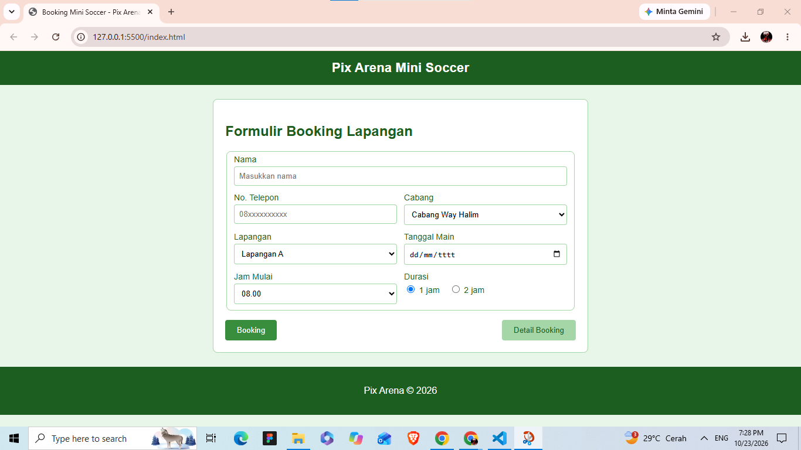
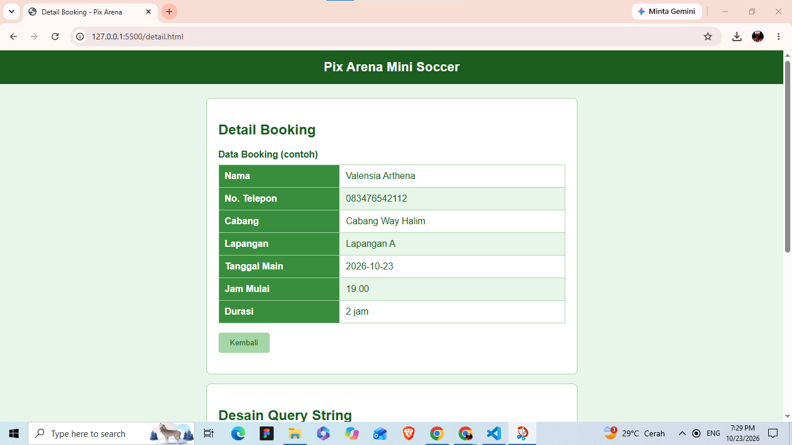

# Booking Lapangan Mini Soccer - Pix Arena

Tugas 3 Pengembangan Aplikasi Web

- **Nama:** Hafidz Raihan Putra Anfa
- **NIM:** 124140108
- **Kelas:** RA

## Deskripsi Program

Web ini berfungsi sebagai tempat booking lapangan mini soccer Pix Arena. Terdapat dua halaman:

- **Halaman form** (`index.html`) berisi formulir booking: nama, no. telepon, cabang, lapangan, tanggal main, jam mulai, dan durasi.
- **Halaman detail** (`detail.html`) menampilkan informasi booking dalam bentuk tabel, beserta tabel yang menjelaskan desain query string.

Formulir memakai method GET, sehingga isian ikut terbawa di URL halaman detail sebagai query string. Halaman detail masih menampilkan data contoh (dummy).

## Struktur Program

```
task_3/
├── Screenshoot/
│   ├── Ss_Form.png     # screenshot halaman form
│   └── Ss_Detail.png   # screenshot halaman detail
├── index.html          # halaman form booking
├── detail.html         # halaman detail booking dan desain query string
├── style.css           # stylesheet untuk kedua halaman
└── README.md
```

## Cara Menjalankan

1. Unduh atau clone repository ini.
2. Pastikan `index.html`, `detail.html`, dan `style.css` berada dalam satu folder.
3. Buka `index.html` dengan browser (klik dua kali, atau klik kanan lalu *Open with* browser). Bisa juga lewat VS Code dengan ekstensi Live Server: klik kanan `index.html`, pilih **Open with Live Server** (default `http://127.0.0.1:5500`).
4. Isi formulir lalu klik tombol **Booking** untuk menuju halaman detail, atau klik **Detail Booking** untuk melihat halaman detail langsung.

## Screenshot

### Halaman Form



### Halaman Detail



### Query String

Contoh URL yang dihasilkan form saat tombol Booking ditekan:

```
detail.html?nama=Valensia+Arthena&hp=083476542112&cabang=Cabang+Way+Halim&lapangan=Lapangan+A&tanggal=2026-10-23&jam=19.00&durasi=2+jam
```

| Variabel | Asal Input  | Contoh Nilai      |
|----------|-------------|-------------------|
| nama     | Nama        | Valensia+Arthena  |
| hp       | No. Telepon | 083476542112      |
| cabang   | Cabang      | Cabang+Way+Halim  |
| lapangan | Lapangan    | Lapangan+A        |
| tanggal  | Tanggal Main| 2026-10-23        |
| jam      | Jam Mulai   | 19.00             |
| durasi   | Durasi      | 2+jam             |
